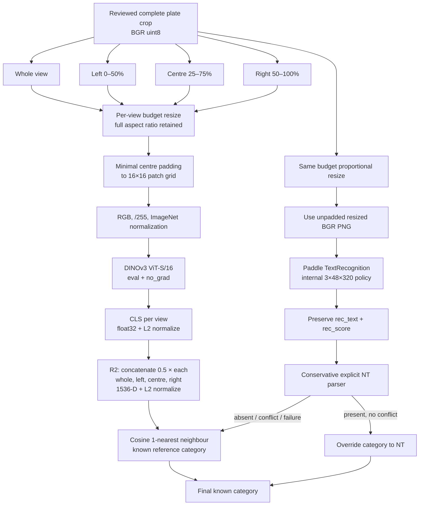
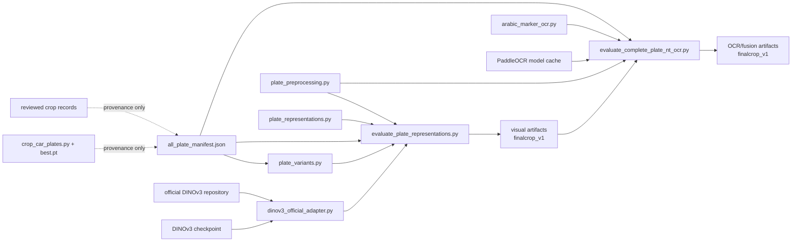

# Pipeline Diagrams

## Processing and decision flow

The visual evaluator and OCR evaluator are two separate scripts. In the recorded experiment, OCR fusion reads saved leave-one-out R2 predictions; the diagram expresses the logical method, not an implemented online service.

## Component dependencies

