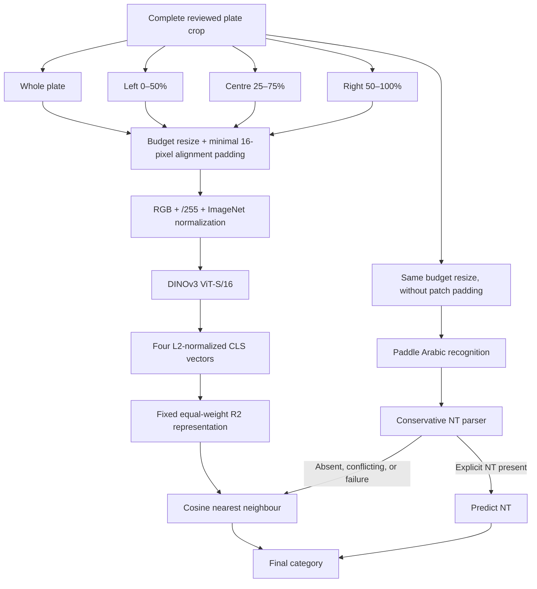

# Last Successful Plate-Category Implementation

## 1. What this implementation does

The last successful configuration classifies an already cropped Tunisian license plate into one of four categories:

- `idara`
- `nt`
- `shorta`
- `tunis`

It combines two fixed branches:

1. **Visual category matching:** DINOv3 ViT-S/16 with the R2 whole-and-regional representation and cosine nearest-neighbour matching.
2. **Positive NT evidence:** PaddleOCR `arabic_PP-OCRv5_mobile_rec` reads the complete resized plate. An exact, conservative parser overrides the visual result to `nt` only when explicit `ن ت` or `نت` evidence is found.

On the current 12-image development collection, the saved visual R2 result is 11/12 and the final OCR-assisted result is 12/12. This is category classification, not reliable registration-number transcription.

The implementation is currently an evaluation workflow composed of two scripts. It is not integrated into the vehicle application and does not yet expose a reusable new-image inference API.

## 2. Authoritative inputs and outputs

### Dataset

The only authoritative manifest is `all_plate_manifest.json`. It contains these current labels:

| IDs | Category | Count |
|---|---|---:|
| 1–3 | idara | 3 |
| 4–7 | nt | 4 |
| 8–9 | shorta | 2 |
| 10–12 | tunis | 3 |

The manifest points directly to complete crops under `plates/<category>/<id>.png`. It records decoded dimensions, registration metadata, image hashes, and optional marker boxes. Marker boxes are not used by the successful R2 + complete-plate OCR decision path. Registration strings are also not classification features.

Manifest validation in `plate_variants.py:113–213` verifies numerical ID order, exact file paths, directory/category agreement, dimensions, marker bounds, hashes, and exact duplicates. All 12 files passed, with no exact duplicate hashes. Physical independence is unverified because all `physical_plate_id` and `group_id` values are null.

### Authoritative successful outputs

Visual artifacts:

- `dinov3_s_all12_budget_finalcrop_v1/representation_results.json`
- `dinov3_s_all12_budget_finalcrop_v1/leave_one_out_predictions.csv`
- `dinov3_s_all12_budget_finalcrop_v1/all_pairs_full.csv`
- `dinov3_s_all12_budget_finalcrop_v1/REPRESENTATION_EXPERIMENT_REPORT.md`
- `dinov3_s_all12_budget_finalcrop_v1/exact_tensor_inputs/`
- `dinov3_s_all12_budget_finalcrop_v1/regions/`

OCR/fusion artifacts:

- `complete_plate_nt_ocr_finalcrop_v1/complete_plate_ocr_fusion.csv`
- `complete_plate_nt_ocr_finalcrop_v1/complete_plate_ocr_fusion.json`
- `complete_plate_nt_ocr_finalcrop_v1/native_ocr_outputs.json`
- `complete_plate_nt_ocr_finalcrop_v1/summary_metrics.json`
- `complete_plate_nt_ocr_finalcrop_v1/experiment_configuration.json`
- `complete_plate_nt_ocr_finalcrop_v1/submitted_budget_crops/`
- `complete_plate_nt_ocr_finalcrop_v1/COMPLETE_PLATE_NT_OCR_REPORT.md`

## 3. Active processing flow



The recorded fusion run reads the saved R2 leave-one-out predictions rather than running DINOv3 again.

## 4. Budget rectangular preprocessing

The policy is implemented by `ResolutionPolicy` and `calculate_geometry` in `plate_preprocessing.py:24–32,191–262`.

Fixed settings:

| Setting | Value |
|---|---|
| Approximate target area | 50,176 pixels |
| Maximum resized long edge | 1,008 pixels |
| Maximum padded patch count | 512 |
| Resize interpolation | OpenCV bicubic (`INTER_CUBIC`) |
| Padding RGB | `(124,116,104)` |
| DINOv3 patch size | 16×16 |
| Cropping during preprocessing | None |

For source width `W` and height `H`:

```text
requested_scale = sqrt(50176 / (W × H))
scale_after_edge_limit = min(requested_scale, 1008 / max(W,H))
```

If the resulting patch-aligned dimensions would exceed 512 patches, binary search reduces the scale. Resized dimensions use round-half-up independently. Each dimension is then rounded upward to the next multiple of 16. Minimal padding is centred; when padding is odd, the extra pixel goes to the right or bottom. The complete resized image is preserved.

`resize_and_pad` performs one proportional resize and constant padding (`plate_preprocessing.py:265–294`). `prepare_variable_input` verifies a float32 tensor shaped `[1,3,H,W]`, with both dimensions divisible by 16 (`343–379`).

### Current whole-plate dimensions

| ID | Source W×H | Resized W×H | DINO tensor | Patch grid/count |
|---:|---:|---:|---:|---:|
| 1 | 680×159 | 463×108 | 1×3×112×464 | 7×29 / 203 |
| 2 | 650×203 | 401×125 | 1×3×128×416 | 8×26 / 208 |
| 3 | 800×159 | 502×100 | 1×3×112×512 | 7×32 / 224 |
| 4 | 823×200 | 454×110 | 1×3×112×464 | 7×29 / 203 |
| 5 | 129×35 | 430×117 | 1×3×128×432 | 8×27 / 216 |
| 6 | 516×136 | 436×115 | 1×3×128×448 | 8×28 / 224 |
| 7 | 562×141 | 447×112 | 1×3×112×448 | 7×28 / 196 |
| 8 | 132×39 | 412×122 | 1×3×128×416 | 8×26 / 208 |
| 9 | 157×44 | 423×119 | 1×3×128×432 | 8×27 / 216 |
| 10 | 420×132 | 400×126 | 1×3×128×400 | 8×25 / 200 |
| 11 | 168×54 | 395×127 | 1×3×128×400 | 8×25 / 200 |
| 12 | 244×61 | 448×112 | 1×3×112×448 | 7×28 / 196 |

## 5. DINOv3 visual branch

### Model

| Item | Current value |
|---|---|
| Architecture | DINOv3 ViT-S/16 |
| Pretraining | LVD-1689M web images |
| Local entry point | `dinov3_vits16` |
| Checkpoint | `checkpoints/dinov3/dinov3_vits16_pretrain_lvd1689m-08c60483.pth` |
| Checkpoint SHA-256 | `08c60483bc63c04f533611e34bf70b120eedb7240f469bc16e9e20bf344b941d` |
| Official repository | `third_party/third_party/dinov3` |
| Repository revision | `6876159a11b4df116f30f667f8c9888617df0751` |
| Patch size | 16×16 |
| Feature dimension | 384 |
| Storage/register tokens | 4, excluded from representations |
| Saved execution device | CPU |
| Precision | float32 pooled features |
| Mode | `eval()` and `torch.no_grad()` |

`dinov3_official_adapter.load_official_dinov3` validates the exact checkpoint name and loads it using the official local PyTorch Hub interface (`dinov3_official_adapter.py:83–106`):

```python
torch.hub.load(repo, "dinov3_vits16", source="local", weights=checkpoint)
```

The official architecture is fixed locally in `third_party/third_party/dinov3/dinov3/hub/backbones.py:199–235`. Rectangular grids are supported through the model’s two-dimensional RoPE calculation for the actual patch height and width.

### Pixel normalization

`MetaDinoV3Processor` does not resize or centre-crop (`dinov3_official_adapter.py:22–43`). It:

1. converts to RGB;
2. converts to float32;
3. divides by 255;
4. normalizes using mean `(0.485,0.456,0.406)` and standard deviation `(0.229,0.224,0.225)`.

The adapter calls official `forward_features`, extracts `x_norm_clstoken` and `x_norm_patchtokens`, and excludes storage/register tokens (`dinov3_official_adapter.py:65–80`).

## 6. R2 representation

R2 uses four views cut from the original complete crop before resizing:

```text
whole  = complete crop
left   = x [0, 0.50W), full height
centre = x [0.25W, 0.75W), full height
right  = x [0.50W, W), full height
```

Lower horizontal bounds use floor, upper bounds use ceil, and coordinates are clamped (`plate_representations.py:21–39`). Each view is independently budget-resized and passed through DINOv3. Each CLS feature is converted to float32 and L2-normalized (`plate_representations.py:170–183`).

For plate `A`, define four unit vectors:

```text
uW(A), uL(A), uC(A), uR(A) ∈ R^384
```

The pair score is:

```text
R2(A,B) = 0.25 cosine(uW(A),uW(B))
        + 0.25 cosine(uL(A),uL(B))
        + 0.25 cosine(uC(A),uC(B))
        + 0.25 cosine(uR(A),uR(B))
```

The implementation constructs an equivalent 1,536-dimensional vector by concatenating `0.5 ×` each normalized component and normalizing the result. It verifies equivalence to the direct weighted score within `1e-6` (`plate_representations.py:191–225`). R2 therefore requires four model forwards per plate.

## 7. Visual reference matching

The evaluator generates embeddings once and caches them in memory. It does not save a reusable embedding database.

For every query in leave-one-out evaluation:

1. exclude the query itself;
2. exclude references with a matching non-null physical/group ID;
3. calculate R2 cosine similarity against eligible references;
4. select the highest-scoring reference;
5. use that reference’s category as the visual prediction.

Tie tolerance is `1e-12`; the smallest numerical reference ID wins a tie while `tie_flag` remains true (`plate_variants.py:383–432`). No rejection threshold is implemented. Consequently, the visual branch always returns one of the four known categories.

The correct-category margin is:

```text
best same-category similarity - best different-category similarity
```

It is an evaluation statistic using labels, not a deployable confidence value.

## 8. PaddleOCR branch

### Recognizer

| Item | Current value |
|---|---|
| Model | `arabic_PP-OCRv5_mobile_rec` |
| Interface | `paddleocr.TextRecognition` |
| Cached assets | `/home/mohamed/.paddlex/official_models/arabic_PP-OCRv5_mobile_rec/` |
| Saved device | CPU |
| Text detection | Disabled/not used |
| Orientation classification | Not used |
| Unwarping | Not used |
| Input scope | Complete plate, not marker crop |

The OCR script reads the exact visual budget policy, generates the same proportional whole-plate resized content, and submits the **unpadded** resized PNG (`evaluate_complete_plate_nt_ocr.py:204–247`). DINO patch padding is not sent to OCR.

The recognizer’s local `inference.yml` configures BGR decoding, proportional recognition resize to height 48, a configured width of 320, and CTC decoding. With batch size one, the installed processor preserves aspect ratio, right-pads to width 320 for these inputs, converts to CHW float32, divides by 255, then applies `(x−0.5)/0.5`.

Paddle returns:

```json
{
  "res": {
    "input_path": "...",
    "page_index": null,
    "rec_text": "...",
    "rec_score": 0.0
  }
}
```

`rec_text` is preserved exactly. `rec_score` is native recognizer confidence and is not treated as a calibrated category probability.

## 9. NT parser

The parser is implemented in `arabic_marker_ocr.py:64–121`.

Normalization:

- Unicode NFKC normalization;
- remove U+0640 tatweel;
- remove Unicode `Mn` diacritics/marks;
- remove whitespace from the saved normalized string;
- preserve Arabic base-letter and dot identity;
- preserve Latin and Arabic-Indic digits;
- perform no fuzzy correction.

The explicit NT regex accepts an Arabic nun, optional whitespace, then Arabic ta:

```text
ن\s*ت
```

The character immediately before `ن` and after `ت` must not be another Arabic base letter. String boundaries, digits, punctuation and separators are permitted. Therefore `ن ت ١١٦٤`, `نت68`, and `نت١0379` supply NT evidence, while an occurrence embedded in a longer Arabic word does not.

Explicit `شرطة` or `تونس` evidence is treated as conflicting. Empty or unmatched output is `absent`, not proof that the plate is non-NT.

## 10. Final decision rule

The implemented rule in `evaluate_complete_plate_nt_ocr.py:265–316` is:

```python
visual_prediction = saved_r2_prediction

if ocr_completed and nt_evidence == "present":
    final_prediction = "nt"
else:
    final_prediction = visual_prediction
```

This means:

- unambiguous NT evidence overrides any visual category;
- absent evidence retains the R2 result;
- conflicting evidence retains the R2 result;
- OCR failure retains the R2 result;
- no `unknown` result exists;
- no OCR confidence threshold is applied.

## 11. Verified per-image results

| ID | Expected | R2 prediction | Nearest reference | R2 similarity | Margin | Raw OCR | NT evidence | Final |
|---:|---|---|---:|---:|---:|---|---|---|
| 1 | idara | idara | 3 | 0.862616 | 0.158259 | `17 - 138957` | absent | idara |
| 2 | idara | idara | 1 | 0.818841 | 0.155301 | `17-148885` | absent | idara |
| 3 | idara | idara | 1 | 0.862616 | 0.183617 | `17 - 138956` | absent | idara |
| 4 | nt | nt | 6 | 0.708208 | 0.003851 | `ن ت ١١٦٤` | present | nt |
| 5 | nt | tunis | 12 | 0.673749 | −0.033851 | `نت١0379` | present | **nt** |
| 6 | nt | nt | 7 | 0.713761 | 0.053674 | `نت68` | present | nt |
| 7 | nt | nt | 6 | 0.713761 | 0.101208 | `نت٦2٦75` | present | nt |
| 8 | shorta | shorta | 9 | 0.632048 | 0.054623 | `300` | absent | shorta |
| 9 | shorta | shorta | 8 | 0.632048 | 0.110973 | `a27211` | absent | shorta |
| 10 | tunis | tunis | 12 | 0.694396 | 0.048318 | `توشن` | absent | tunis |
| 11 | tunis | tunis | 12 | 0.724479 | 0.077810 | `937 ن 2` | absent | tunis |
| 12 | tunis | tunis | 11 | 0.724479 | 0.050730 | `ؤن` | absent | tunis |

Image 5 is the sole visual error and sole override. Its OCR output contains valid NT evidence but incorrect/incomplete registration digits; this is why the result supports category evidence only.

### Final metrics

Visual R2:

- correct: 11/12;
- idara recall: 3/3;
- NT recall: 3/4;
- Shorta recall: 2/2;
- Tunis recall: 3/3;
- macro-F1: 0.9286;
- balanced accuracy: 0.9375.

OCR NT detection:

- true positives: 4;
- false positives: 0;
- false negatives: 0;
- true negatives: 8;
- precision: 4/4;
- recall: 4/4.

Final fusion:

- correct: 12/12;
- every category recall: 1.0;
- corrections: image 5;
- regressions: none;
- false NT overrides: none;
- conflicts: none;
- inference failures: none.

## 12. Runtime record

The authoritative successful run was CPU-based.

DINOv3:

- model load: 2.239 seconds;
- two warm-up forwards excluded;
- 12 whole forwards: 1.043 seconds total;
- 36 regional forwards: 3.002 seconds total;
- total R2 model-forward time for 12 plates: 4.045 seconds;
- peak GPU memory: unavailable because CPU was used.

PaddleOCR:

- model load: 2.315 seconds;
- warm-up: 0.227 seconds;
- 12 recognition calls: 1.429 seconds total;
- mean recognition: 0.1191 seconds/image;
- median recognition: 0.09585 seconds/image.

These are experiment measurements, not complete service latency. DINO timing excludes preprocessing, file I/O, matching, and report generation. OCR per-image timing excludes loading and warm-up.

## 13. Reproduction commands

Both scripts refuse to overwrite an existing directory, so use fresh output names:

```bash
cd /mnt/d/temporary/test/plate_similarity_test

MPLCONFIGDIR=/tmp/matplotlib-dinov3 \
/home/mohamed/miniconda3/envs/ml/bin/python evaluate_plate_representations.py \
  --manifest all_plate_manifest.json \
  --encoder dinov3_vits16 \
  --dinov3-repo third_party/third_party/dinov3 \
  --dinov3-checkpoint checkpoints/dinov3/dinov3_vits16_pretrain_lvd1689m-08c60483.pth \
  --input-mode budget \
  --device cpu \
  --output-dir dinov3_s_all12_budget_reproduction

MPLCONFIGDIR=/tmp/matplotlib-ocr \
/home/mohamed/miniconda3/envs/ml/bin/python evaluate_complete_plate_nt_ocr.py \
  --manifest all_plate_manifest.json \
  --visual-baseline-dir dinov3_s_all12_budget_reproduction \
  --output-dir complete_plate_nt_ocr_reproduction \
  --device cpu
```

## 14. What remains missing

The successful implementation still lacks:

- a frozen, serialized reference embedding gallery;
- a CLI/API for one genuinely new plate;
- unknown-category or low-similarity rejection;
- validated automatic plate localization;
- independent plates not used during development;
- calibrated OCR/category confidence;
- established registration-digit recognition;
- production application integration.

The defensible conclusion is limited: this fixed implementation correctly classified the 12 current reviewed development crops. It must be frozen and evaluated on physically independent crops before deployment decisions.

## Supporting files

- [Files used by the successful implementation](FILES_USED.md)
- [Machine-readable frozen configuration](SUCCESSFUL_CONFIGURATION.json)
- [Machine-readable per-image results](SUCCESSFUL_PER_IMAGE_RESULTS.csv)

