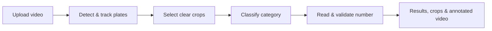

# Vehicle AI


**Recorded footage. Local GPU inference. Clear plate results.**

A Django + React platform for license-plate recognition, vehicle colour analysis,
and vehicle classification.

## Current milestone · Offline recognition

Upload a video, review recognized plates and their evidence, and replay the
annotated result. License-plate models run locally on the GPU, without external
recognition APIs. Model assets must be installed beforehand; CPU fallback is disabled.



- **Category:** Arabic OCR identifies NT; DINOv3 matches Tunis, Idara, and Shorta references.
- **Tunis:** marker-first mode locates “تونس”, then reads the left and right digit regions.
- **Other categories:** whole-crop OCR reads NT, Idara, and Shorta numbers.
- **Validation:** format and confidence checks keep uncertain readings unresolved.

## Run locally

Requires **Linux x86_64, Python 3.11, an NVIDIA GPU**, local model assets, and FFmpeg.

**Backend** — activate your GPU environment, then:

```bash
cd vehicle
python -m pip install -r requirements.txt
python manage.py migrate
export TUNIS_USE_LEGACY_WHOLE_OCR=
python manage.py runserver 8001
```

> The legacy switch currently reads a string: an empty value selects marker-first
> OCR; any nonempty value, including `0`, enables the retained whole-plate flow.

**Frontend** — in another terminal:

```bash
cd frontend
npm install
VITE_API_URL=http://127.0.0.1:8001 npm run dev
```

Set `CORS_ALLOWED_ORIGINS` in `vehicle/.env` to your frontend origin.
Generated results are stored in `vehicle/media/`.

> **GPU setup:** PyTorch and Paddle share NVIDIA library paths. If PyTorch reports
> `undefined symbol: ncclCommShrink` after dependency installation, restore its
> required library with
> `python -m pip install --force-reinstall --no-deps nvidia-nccl-cu12==2.28.9`.

## Next milestone · Live RTSP recognition

RTSP session controls and a stream reader already exist. The next step is to
complete and validate continuous, low-latency camera processing:

1. Replay recorded footage through a local RTSP stream.
2. Measure camera-to-result delay, processing speed, and queue pressure.
3. Validate stale-frame handling, reconnects, and long-running stability.
4. Test real cameras under traffic, motion blur, and changing light.

**Offline is the current baseline. Real-time performance is the next milestone.**

## Project map

| Folder | Purpose |
| --- | --- |
| `vehicle/` | Django API and computer-vision services |
| `vehicle/license_plate_service/run_video_pipeline/` | Offline plate pipeline and category plugin |
| `vehicle/license_plate_service/run_rtsp_pipeline/` | Live-stream implementation scaffold |
| `frontend/` | React / Vite workspace |
| `services/` | Preserved standalone pipelines |
| `docs/` | Technical notes and audits |

**Checks:** run `python manage.py check` from `vehicle/`, and
`npm run lint` / `npm run build` from `frontend/`.
